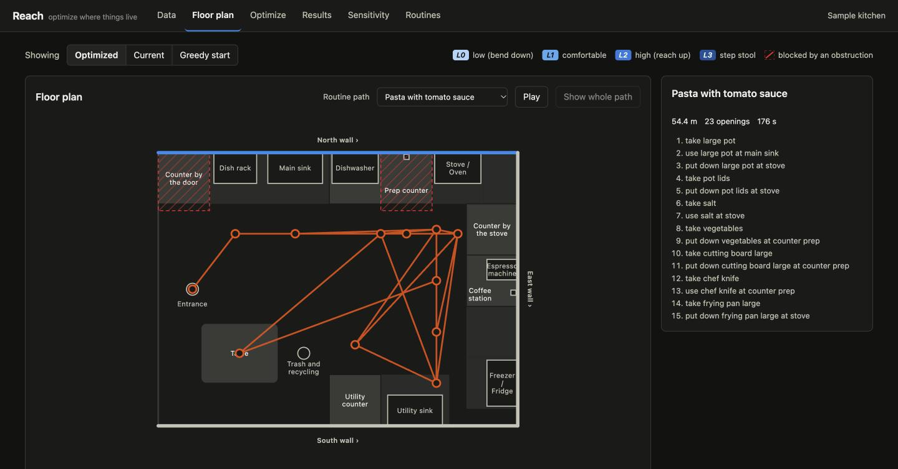
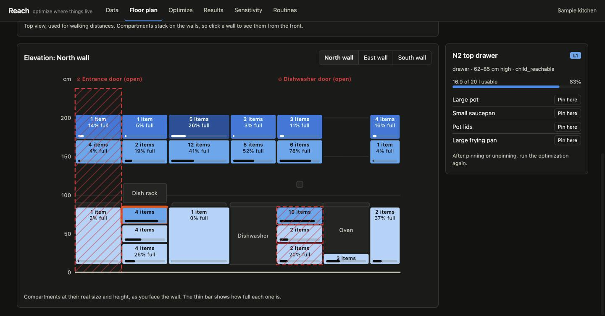
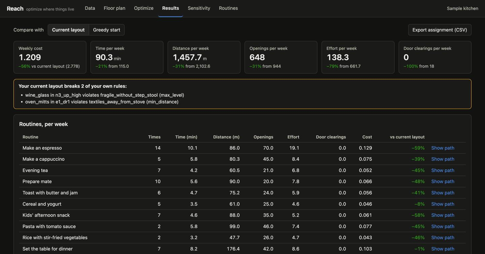
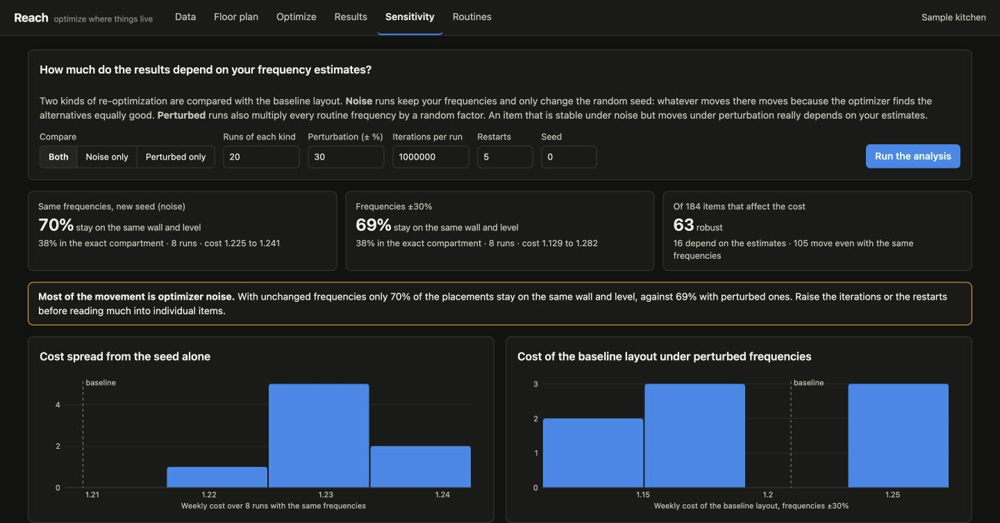

# Reach

**Optimize where things live, starting with your kitchen.**

> 🚧 **Building in public.** Version 0.1 works end to end on a sample kitchen: engine, command
> line, web app. It has not been run on a real, measured kitchen yet; that is the next step on the
> roadmap below.



## The problem

Where you store things shapes every routine. If the espresso tamper lives two drawers away from
the grinder, or the pot you use daily sits behind a door that needs a step stool, you pay for it
in steps, openings, and bending down — every single day.

Most people organize their kitchen by intuition. That works, but it can't answer questions like:

- How much walking does my morning coffee actually involve?
- If I move the pans to this drawer, which routines get better and which get worse?
- Is my layout robust, or does it only work if my guesses about how often I cook are right?

## The idea

Reach treats storage as an optimization problem:

1. **Describe the space.** A 2D floor plan of your kitchen: drawers, cabinet doors, pantry
   shelves, the stove, sinks, fridge, and countertop zones, with their positions, heights, and
   capacities.
2. **List your items.** Each one with its volume, weight, and whether it nests with others (pots,
   plates, food containers).
3. **Describe your routines.** Everyday activities — making espresso, evening tea, washing dishes,
   a specific recipe — as sequences of steps, each with a weekly frequency.
4. **Optimize.** Reach simulates every routine under a given storage layout, measures the cost,
   and searches for the assignment of items to compartments that minimizes it.

### What it measures

- **Distance walked** between compartments and work areas.
- **Openings** of drawers and doors (opening a drawer once to take three things counts once).
- **Estimated time**, combining walking and openings.
- **Ergonomic effort**: bending down, reaching up, and climbing a step stool, weighted by how
  heavy the item is.
- **Obstruction clearings**: how often you have to close a door that is in the way.

Each metric is reported per routine and as a weekly total, so you can see the trade-offs instead
of trusting a single score.

### What it respects

Real kitchens have rules. Reach supports **hard constraints** (cleaning products never next to
food, knives out of children's reach, heavy things low, items you want pinned in place) and
**soft constraints** (keep all the espresso gear together).

### Writing routines without the tedium

Describing routines step by step is the hardest part, so Reach helps:

- **From natural language:** describe an activity or paste a recipe, and an LLM drafts the
  routine using your actual item catalog.
- **From a usage diary:** jot down what you did in the kitchen each day in a phone note, import
  the file, and get routines with *measured* frequencies instead of guesses.
- **Coverage analysis:** see which items no routine uses and where your estimates disagree.

LLM features are optional and only ever *propose*: everything is reviewed by you before it
affects the optimization. Reach works fully without an API key.

### Trusting the result

Usage frequencies are estimates. Reach's sensitivity analysis re-optimizes under perturbed
frequencies and shows which item locations are robust and which depend on your guesses. It also
re-optimizes with the *same* frequencies and a different random seed, to show how much of the
movement is just the optimizer choosing between equally good layouts. On the sample kitchen that
is nearly all of it: see decision 33 in [`docs/DECISIONS.md`](docs/DECISIONS.md).

## Beyond the kitchen

The engine is domain-agnostic: locations, items, tasks, and a cost model. The kitchen is the
first use case, but the same approach applies to workshops, labs, supply rooms, or small
warehouses. In logistics this family of problems is known as *slotting optimization*.

## Quick start

You need [uv](https://docs.astral.sh/uv/) and, for the web app, Node 20 or newer.

```bash
git clone https://github.com/tlifschitz/reach.git && cd reach
make install        # uv sync + npm install
make dev            # API on :8000, web app on http://localhost:5173
```

Open the web app, press **Use the sample kitchen**, then **Optimize**.

Without Node, the command line does everything except draw:

```bash
uv sync
uv run reach optimize            # the bundled sample kitchen
```

Or with Docker, which builds the web app and serves it from the API:

```bash
docker build -t reach .
docker run --rm -p 8000:8000 reach        # http://localhost:8000
```

## Using it

### Web app

| View | What it does |
| --- | --- |
| **Data** | Upload your files or load the sample. Every validation problem is listed with its file, line and field. |
| **Floor plan** | Top view with POIs, zones, walls and obstructions. Pick a routine to draw and animate its path. Click a wall to open its **elevation**: compartments at their real size and height, coloured by level, with their contents and how full they are. Pin or unpin items there. |
| **Optimize** | Choose a seed, a budget and a number of restarts, watch the best cost improve, stop early and keep the best solution so far. |
| **Results** | What goes in each compartment with the capacity used, every metric per routine and per week, and the comparison with your current layout. Export the assignment as CSV. |
| **Sensitivity** | Re-optimizes with new seeds and with perturbed frequencies, so you can tell optimizer noise from real dependence on your estimates. Stability is shown by exact compartment and by wall and level. |
| **Routines** | Edit routines, draft them from a description, a recipe or a usage diary, and check coverage. |







On the sample kitchen the optimized layout cuts the weekly cost by 56% against the hand-made
"current" layout: 31% less walking, 31% fewer openings, 21% less time, and no more closing the
entrance door to reach a cabinet.

### Command line

Every command takes a project folder and defaults to the bundled sample. Add `--json` for
machine-readable output.

```bash
reach validate my-kitchen/                       # check the files
reach simulate my-kitchen/ --current             # metrics of current_assignment.csv
reach optimize my-kitchen/ --seed 1 --out best.csv
reach optimize my-kitchen/ --time-limit 600      # wall-clock budget; Ctrl-C keeps the best so far
reach optimize my-kitchen/ --iterations 200000 --restarts 1   # a quick run, a few seconds
reach sensitivity my-kitchen/ --runs 20 --perturbation 0.3
reach sensitivity my-kitchen/ --mode baseline    # optimizer noise only: same frequencies, new seeds
reach coverage my-kitchen/
reach serve                                      # the web app, if the frontend is built
```

With an iteration budget (the default), the same seed always gives the same result. The default
is 1,000,000 iterations × 5 restarts: under a minute for the sample, about ten minutes for a
full sensitivity analysis.

### LLM helpers (optional)

Reach works fully without an API key. With `ANTHROPIC_API_KEY` set, four helpers become
available in the Routines view and under `reach llm`. Each one writes a proposal for you to
review; none of them changes your project on its own.

```bash
reach llm routine "On Sundays I make pancakes..." --project my-kitchen/
reach llm routine --url https://example.com/recipe --project my-kitchen/
reach llm diary my-kitchen/diary.txt --project my-kitchen/      # measured weekly frequencies
reach llm cover --project my-kitchen/                           # routines for unused items
reach llm constraints --project my-kitchen/                     # from the comments in items.csv
```

The model is `claude-opus-5-5` unless `REACH_LLM_MODEL` says otherwise. These helpers are covered
by tests with a scripted client; they have not been exercised against the live API yet.

## Your own kitchen

Copy [`data/templates`](data/templates), fill the files in, and run `reach validate` as you go.
[`docs/DATA_COLLECTION.md`](docs/DATA_COLLECTION.md) explains what to measure and how.

| File | Contents |
| --- | --- |
| `kitchen.yaml` | Walls, POIs, countertop zones, compartments (with their rectangle on a wall and their volume), obstructions, and every cost parameter. |
| `items.csv` | One row per item: `id, name, category, volume_l, quantity, weight_kg, estimated_frequency_per_week, nest_group, fixed_location, tags, comments`. |
| `routines.yaml` | Activities as ordered steps, each with a weekly frequency. |
| `constraints.yaml` | Optional. Hard rules and soft "keep together" groups. |
| `current_assignment.csv` | Optional. Where things are today, for the before/after comparison. |

A compartment and a routine look like this:

```yaml
# kitchen.yaml
compartments:
  - id: n2_dr1
    type: drawer                 # drawer | door | pantry_shelf
    access_point: [90, 95]       # where you stand, on the floor plan (cm)
    wall: north                  # its rectangle on the wall elevation:
    offset_cm: 60
    width_cm: 60
    bottom_cm: 62                # the level (0-3) is derived from the height
    top_cm: 85
    volume_l: 29
    tags: [child_reachable]

obstructions:
  - id: entrance_door            # open by default, and in the way while open
    default_state: open
    blocks_when: open
    wall_range: {wall: north, from_cm: 0, to_cm: 60}
    clear: {time_s: 3, openings: 1}
    restore: {time_s: 3, openings: 1}
```

```yaml
# routines.yaml
routines:
  - id: evening_tea
    name: Evening tea
    frequency_per_week: 7
    start: table
    steps:
      - take: electric_kettle
      - use: electric_kettle at main_sink
      - put_down: electric_kettle at coffee_station
      - take: mug
      - take: tea_tin_herbal
      - use: tea_tin_herbal at coffee_station
      - store: tea_tin_herbal
      - put_down: mug at table
```

## How it works

Reach simulates each routine step by step under a candidate layout and measures distance,
openings, time, ergonomic effort and obstruction clearings. The cost is the weighted sum of
those metrics, normalized and multiplied by each routine's weekly frequency, plus penalties for
soft constraints. Items that no routine mentions are charged a generic round trip from the
middle of the room, weighted by how often you estimate you use them, and reported as their own
"occasional items" line. A greedy pass builds a feasible layout and simulated annealing improves it;
every layout the search visits respects capacity and the hard constraints, so stopping early
always leaves a usable result.

The formulas, the algorithm and the code layout are in
[`docs/ARCHITECTURE.md`](docs/ARCHITECTURE.md). The judgment calls are in
[`docs/DECISIONS.md`](docs/DECISIONS.md).

## Development

```bash
make test       # pytest: unit, integration and end-to-end on the sample
make lint       # ruff + TypeScript
make format
```

The engine in `src/reach/core` knows nothing about kitchens; a test enforces that. Kitchen
vocabulary lives in `src/reach/io`, the sample data and the frontend.

## Roadmap

- [x] Data model and validation (floor plan, items, constraints, routines)
- [x] Routine simulation and metrics
- [x] Optimizer (greedy initial solution + simulated annealing)
- [x] CLI
- [x] Web interface with floor plan view
- [x] Wall elevations with real compartment heights
- [x] Obstructions (doors that block compartments)
- [x] Sample kitchen and data collection guide
- [x] Sensitivity analysis
- [x] LLM-assisted routine generation and constraint suggestions
- [x] Usage diary import
- [x] Animated routine paths on the floor plan
- [ ] LLM helpers verified against the live API
- [ ] My own kitchen, measured: real before/after results

## Building in public

This project is being built with AI-assisted development. The original specification is in
[`docs/ORIGINAL_PROMPT.md`](docs/ORIGINAL_PROMPT.md), and design decisions are logged in
[`docs/DECISIONS.md`](docs/DECISIONS.md) as they're made. Changes made to the spec along the way are recorded in
[`docs/SPEC_CHANGES.md`](docs/SPEC_CHANGES.md).

## License

MIT